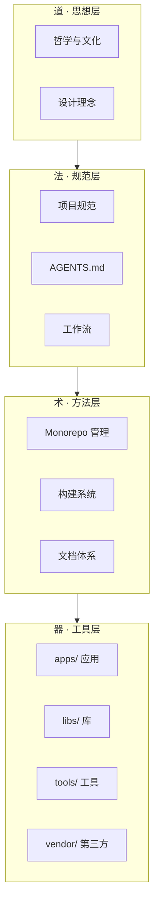

# Xuanspace（玄境）

> 技术为器、思想为道，器以载道


## 关于玄境

"玄境"取自《老子》**"玄之又玄，众妙之门"**。

这是一个技术与文化项目共存的空间。我们相信：

- **技术为器**：工具与实现是基础
- **思想为道**：哲学与文化是灵魂
- **器以载道**：技术服务于更高的思想追求

玄境同时容纳多种类型的项目：Python 库、C++ 原生扩展、CLI 工具、静态 HTML 文化项目（如竹简悟道）等。在这里，代码不仅是解决问题的工具，更是承载思想的载体。

## 特性亮点

- 📦 **Monorepo 架构**：统一管理多个子项目，workspace 自动链接
- 🐍 **Python 3.14.6+**：严格遵循最新 Python 标准
- 🔧 **多包管理器支持**：PDM（推荐）、uv（快速）、pip（标准）均可使用，不强制绑定
- ⚡ **C++ 原生扩展**：集成 CMake + Ninja + scikit-build-core 构建链，跨平台一致
- 📚 **Sphinx 文档**：MyST Markdown 语法，支持 Mermaid 图表，美观的文档主题
- 🤖 **AI Agent 就绪**：内置 AGENTS.md 和 `.agents/` 规范目录，支持 AI 协作开发
- 🧩 **插件化装配**：`xuan-plugin` 内核按能力键（provide/inject）求解并可逆装配，`xs` 的命令面、构建与 FFI 能力均以插件形式接入，装配结果由 `xuan.plugins.lock` 锁定
- 🔄 **版本管理**：`xs` CLI 提供统一版本 bump 和 CHANGELOG 生成
- 🏗️ **跨平台构建**：Windows/macOS/Linux 一致性保证

## 5 分钟快速开始

### 前置条件

- Python 3.14.6+（硬性要求，不兼容版本会给出明确错误）
- Git
- **可选**：PDM（推荐包管理器）
- **可选**：CMake + Ninja（仅构建 C++ 原生扩展需要）

### 安装步骤

1. 克隆仓库：

   ```bash
   git clone https://github.com/xinetzone/xuanspace.git
   ```

   > 子模块默认**延迟初始化**，按需运行 `git submodule update --init <path>`，详见 [CONTRIBUTING.md](CONTRIBUTING.md#35-顶层子模块延迟初始化策略)。

2. 进入项目目录：

   ```bash
   cd xuanspace
   ```

3. 选择一种方式安装依赖：

   **使用 PDM（推荐）：**
   ```bash
   pdm install
   pdm run xs --help
   ```

   **使用 pip（标准）：**
   ```bash
   pip install -e ".[dev]"
   pip install -e tools/xs   # xs CLI 是未发布到 PyPI 的本地发行版，需单独安装（PDM 工作区会自动处理）
   xs --help
   ```

   **使用 uv（快速）：**
   ```bash
   uv pip install -e ".[dev]"
   uv pip install -e tools/xs
   xs --help
   ```

4. 查看所有子项目：

   ```bash
   xs list
   ```

5. 检查开发环境：

   ```bash
   xs doctor
   ```

## 项目索引

| 名称 | 描述 | 语言 | 类型 | 维护状态 | 版本 | 文档 |
|------|------|------|------|---------|------|------|
| xs | Xuanspace CLI 工具（16 个子命令） | Python 3.14 | tools | 活跃 | 0.1.0 | [CLI 参考](doc/cli/index.md) |
| okf | OKF v0.2 工具链（校验/脚手架/合成/信任推导） | Python 3.14 | tools | 活跃 | 0.1.0 | [OKF 文档](doc/okf/index.md) |
| templates | 项目模板（Python/Native/Native-FFI/Static） | 多语言 | tools | 活跃 | 0.1.0 | [模板说明](tools/templates/) |
| caffe-ffi | Caffe 深度学习框架 FFI 绑定 | Python/C++ | lib | 活跃 | 1.2.0 | [README](libs/caffe-ffi/README.md) |
| demo-ffi | FFI 扩展开发模板（Stub/Real 双运行时） | Python/C++ | lib | 孵化中 | 0.1.0 | [README](libs/demo-ffi/README.md) |
| mystx | MyST 文档工具链/主题（子模块） | Python | lib(submodule) | 上游 | - | [README](libs/mystx/README.md) |
| npu-ffi | VTA NPU 加速器 FFI 绑定 | Python/C++ | lib | 孵化中 | 0.1.0 | [README](libs/npu-ffi/README.md) |
| tao | AgentForge：AI Agent 协作基础设施（子模块） | Python | lib(submodule) | 上游 | v0.7.4 | [README](libs/tao/README.md) |
| tvm-book | TVM 中文手册 + flexloopy（子模块） | Python/C++ | lib(submodule) | 上游 | v0.1.4 | [README](libs/tvm-book/README.md) |
| xuan-build | 构建后端能力层：按项目类型分派 python/native/static 构建实现 | Python | lib | 孵化中 | 0.1.0 | [README](libs/xuan-build/README.md) |
| xuan-cmd | 命令装配与工程路径解析工具库（invoke 任务通用件萃取） | Python | lib | 孵化中 | 0.1.0 | [README](libs/xuan-cmd/README.md) |
| xuan-compose | Compose 规范声明式容器编排引擎（podman-compose 重构） | Python | lib | 活跃 | 0.1.0 | [README](libs/xuan-compose/README.md) |
| xuan-core | 核心工具库，提供基础类型、通用函数、错误处理 | Python | lib | 活跃 | 0.1.0 | [README](libs/xuan-core/README.md) |
| xuan-ext-demo | C/C++ 扩展示例库 | Python/C++ | lib | 孵化中 | 0.1.0 | [README](libs/xuan-ext-demo/README.md) |
| xuan-fea | OpenType Feature（.fea）AST 构建原语（Maple Mono 构建系统萃取） | Python | lib | 孵化中 | 0.1.0 | [README](libs/xuan-fea/README.md) |
| xuan-ffi | FFI 能力键与子进程隔离代理：切换后端不改调用方代码 | Python | lib | 孵化中 | 0.1.0 | [README](libs/xuan-ffi/README.md) |
| xuan-plugin | 插件内核：可逆装配、能力注册与生命周期管理 | Python | lib | 孵化中 | 0.1.0 | [README](libs/xuan-plugin/README.md) |
| xuan-project | 工作区项目发现与 pyproject 解析工具库（xs CLI 萃取） | Python | lib | 孵化中 | 0.1.0 | [README](libs/xuan-project/README.md) |
| tvm-ffi | Apache TVM C++ FFI 跨语言绑定库（子模块） | C++ | vendor(submodule) | 上游 | v0.1.12 | [上游仓库](https://github.com/apache/tvm-ffi) |
| caffe | Caffe 深度学习框架（子模块） | C++ | vendor(submodule) | 上游 | - | [上游仓库](https://github.com/daoflows/caffe) |

## 架构设计

玄境遵循**道-法-术-器**四层架构：



### 插件装配视图

运行时装配自下而上分四层，依赖方向单向（下层不感知上层）：

| 层 | 组成 | 职责 |
|----|------|------|
| 内核层 | `libs/xuan-plugin` | 清单解析、provide/inject 求解、冲突检测、可逆装配与生命周期 |
| 能力层 | `libs/xuan-build`、`libs/xuan-ffi` | 按项目类型分派构建实现；以能力键隔离后端子进程 |
| 命令面 | `tools/xs` 的 `xs.commands` 插件 | 把 16 个子命令登记为插件，由内核装配为 CLI |
| 工作区层 | `libs/xuan-project`、`libs/xuan-cmd` | 项目发现、pyproject 解析、路径解析与命令执行通用件 |

`scripts/check_plugin_contract.py` 对 H1–H5 不变量做 CI 断言（可解性、无冲突、可撤销、lock 一致、结构兼容）；清单变更后用 `--write-lock` 重算 `xuan.plugins.lock`。

## 目录结构

```
xuanspace/
├── apps/              # 可执行应用（预留，当前仅有说明）
├── libs/              # 共享库：领域库、能力层与插件内核
├── vendor/            # 第三方依赖（Git 子模块）
├── tools/             # 独立工具集（xs CLI、okf、项目模板）
├── src/               # 根枢纽包 xuanspace（仅版本与元信息）
├── tests/             # 根级契约测试（CLI 快照、装配与文档断言）
├── doc/               # Sphinx 文档源文件
├── scripts/           # 运维与一致性门禁脚本（声明、依赖方向、插件契约）
├── attic/             # 归档内容（不活跃但有参考价值）
├── .agents/           # AI Agent 配置与规范
├── .github/           # CI 与发布工作流
├── .meta/             # 项目元数据（TOML 单源）
├── .trae/             # Spec 资产（specs/）
├── AGENTS.md          # AI 智能体协作指南
├── xuan.plugins.lock  # 插件装配锁（由清单派生的规范 JSON）
└── pyproject.toml     # 根项目配置（纯 Python 枢纽包）
```

## 文档与资源

- 📖 **完整文档**：Sphinx 构建后位于 `doc/_build/html/`
- 🤝 **贡献指南**：详见 [CONTRIBUTING.md](CONTRIBUTING.md)
- 🤖 **AI 协作**：详见 [AGENTS.md](AGENTS.md)
- 🐛 **问题反馈**：[GitHub Issues](https://github.com/xinetzone/xuanspace/issues)
- 📝 **更新日志**：详见 [CHANGELOG.md](CHANGELOG.md)

更多技术细节和开发指南请查阅 `doc/` 目录。

## 许可证

Apache License 2.0 - 详见 [LICENSE](LICENSE) 文件。
