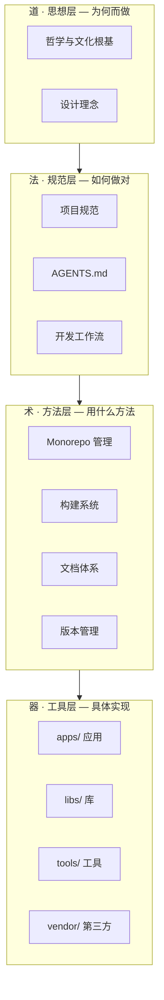

# 架构设计

## 道-法-术-器 四层架构

玄境遵循中国传统哲学中的**道-法-术-器**四层递进架构：



### 道：思想层

决定项目的存在意义和设计哲学。"技术为器、思想为道，器以载道"——技术服务于更高的思想追求。

### 法：规范层

约定如何正确地做事。包括 `AGENTS.md` 智能体协作规范、开发工作流、代码规范、提交规范等。

### 术：方法层

选择具体的技术方案。Monorepo 组织方式、构建系统选型、文档体系设计、版本管理策略。

### 器：工具层

可执行的具体实现。`apps/`、`libs/`、`tools/`、`vendor/` 中的每一行代码。

## Monorepo 结构

### 目录约定

```
xuanspace/
├── apps/              # 可执行应用（当前为空目录，预留应用位）
├── libs/              # 可复用 Python 库、C++ 原生扩展、插件内核与能力层
│   ├── caffe-ffi/     #   Caffe 框架 FFI 绑定（原生扩展）
│   ├── demo-ffi/      #   FFI 扩展开发模板（原生扩展）
│   ├── mystx/         #   MyST 文档工具链/主题（子模块）
│   ├── npu-ffi/       #   VTA NPU 加速器 FFI 绑定（原生扩展）
│   ├── tao/           #   AgentForge：AI Agent 协作基础设施（子模块）
│   ├── tvm-book/      #   TVM 中文手册 + flexloopy（子模块）
│   ├── xuan-build/    #   构建能力层（python/native/static 分派）
│   ├── xuan-cmd/      #   命令装配与工程路径解析
│   ├── xuan-compose/  #   声明式容器编排引擎
│   ├── xuan-core/     #   核心工具库
│   ├── xuan-ext-demo/ #   C/C++ 扩展示例
│   ├── xuan-fea/      #   OpenType Feature（.fea）AST 原语
│   ├── xuan-ffi/      #   FFI 能力键与子进程隔离代理
│   ├── xuan-plugin/   #   插件内核：可逆装配、能力注册、生命周期
│   └── xuan-project/  #   工作区项目发现与 pyproject 解析
├── vendor/            # 第三方依赖（Git 子模块，只读）
├── tools/             # 项目内部工具链
│   ├── xs/            #   xs CLI（16 个子命令，命令面以插件登记）
│   ├── okf/           #   OKF v0.2 工具链
│   └── templates/     #   项目模板
├── src/xuanspace/     # 根枢纽包（仅版本与元信息）
├── tests/             # 根级契约测试（CLI 快照、装配与文档断言）
├── doc/               # Sphinx 文档源文件
├── scripts/           # 一致性门禁脚本（声明/依赖方向/插件契约）
├── attic/             # 归档项目（不活跃但有参考价值）
├── .agents/           # AI 智能体规范目录
├── .github/           # CI/发布工作流
├── .meta/toml/        # 文档元数据（TOML 格式）
├── .trae/             # Spec 资产（specs/）
├── AGENTS.md          # AI 智能体协作入口
├── xuan.plugins.lock  # 插件装配锁（由清单派生的规范 JSON）
├── pyproject.toml     # 根项目配置（PEP 621）
├── CMakePresets.json  # 跨平台构建预设
└── README.md          # 项目说明
```

### 子项目分类

| 目录 | 适用场景 | 示例 |
|---|---|---|
| `apps/` | 可执行应用、CLI 工具、面向最终用户的程序 | 当前为空目录，预留应用位 |
| `libs/` | 可复用的 Python 库、C++ 原生扩展、插件内核与能力层 | xuan-plugin（内核）、xuan-build/xuan-ffi（能力）、xuan-core（核心库） |
| `vendor/` | 第三方依赖、fork 的外部项目（只读） | tvm-ffi、caffe |
| `tools/` | 项目内部工具链、模板、构建辅助 | xs CLI、okf、templates |

## 插件装配架构

`xs` 不再把子命令硬编码在 CLI 入口，而是以插件方式装配。装配自下而上分四层，依赖方向单向（下层不感知上层）：

| 层次 | 组成 | 职责 |
|---|---|---|
| 内核 | `libs/xuan-plugin` | 解析 `[tool.xuan.plugin]` 清单、provide/inject 求解、冲突检测、可逆装配、生命周期管理 |
| 能力 | `libs/xuan-build`、`libs/xuan-ffi` | 构建实现按项目类型分派；FFI 以能力键选择后端并做子进程隔离 |
| 命令面 | `tools/xs` 的 `xs.commands` 插件 | 16 个子命令登记为插件，由内核装配为 CLI |
| 工作区 | `libs/xuan-project`、`libs/xuan-cmd` | 项目发现、pyproject 解析、路径解析与命令执行通用件 |

装配结果写入仓库根的 `xuan.plugins.lock`（`schema=1`，插件按 id 排序，`digest` 为清单契约的 sha256）。清单变更后运行：

```bash
python scripts/check_plugin_contract.py --write-lock   # 重算并写入 lock（需已安装 libs/xuan-plugin 等依赖）
python scripts/check_plugin_contract.py                # 只读校验（CI 同款）
```

CI 通过 H1–H5 不变量保证装配可逆且可审计：H1 可解性（必需 inject 均有提供者）、H2 无冲突（同一能力键的提供者在 mode/priority 下可消解）、H3 可撤销性（入口模块无模块级可变全局、函数内无裸 `global` 写）、H4 视图一致性（lock 必须等于由当前清单重算的规范 JSON）、H5 结构兼容（`methods:<m1,m2>` 约束的方法须存在于提供者入口模块）。

## 依赖管理

### 集中式依赖声明

所有依赖在根 `pyproject.toml` 中按功能分组声明（下方为节选示意，完整清单与版本下限以该文件为单一事实来源）：

```toml
[project.optional-dependencies]
doc = [
    "sphinx>=8.0",
    "myst-parser>=4.0",
    "sphinx-book-theme>=1.1",
    "sphinx-design",
    "sphinx-copybutton",
    "sphinxcontrib-mermaid",
]
test = ["pytest>=8.0", "pytest-cov>=5.0", "pytest-xdist>=3.5"]
lint = ["mypy>=1.10", "ruff>=0.4", "black>=24.4", "isort>=5.13"]
build = ["build>=1.2", "scikit-build-core>=0.11", "cmake>=3.26", "ninja"]

[dependency-groups]
dev = [
    {include-group = "doc"},
    {include-group = "test"},
    {include-group = "lint"},
    {include-group = "build"},
]
```

### 包管理器选择

| 包管理器 | 特点 | 适用场景 |
|---|---|---|
| PDM | Workspace 自动链接，符合 PEP 621 | 推荐，日常开发 |
| uv | 安装速度极快，Rust 实现 | 快速环境搭建 |
| pip | Python 自带，无额外安装 | 标准方式，CI 环境 |

## 版本管理

### 子项目版本

每个子项目独立维护版本号，存储在各自 `pyproject.toml` 的 `version` 字段。

### 版本 bump

```bash
xs version bump <project> --type major|minor|patch
```

### Git 标签

格式：`<project>@<version>`

```
xuan-core@0.2.0
xuan-ext-demo@0.1.1
```

## 子模块策略

### 第三方库（vendor/）

- 仅在需要 patch 第三方库时使用
- 作为 Git 子模块管理
- 保持与上游同步

### 上游派生子模块（libs/）

- 自建库仍位于 `libs/`，仓库中不存在 `projects/` 目录
- 部分库直接以上游仓库子模块形式引入（`mystx`、`tao`、`tvm-book`），只跟随上游、不在此仓库开发
- 其余自建库（`xuan-plugin`、`xuan-build`、`xuan-ffi`、`xuan-project`、`xuan-cmd`、`xuan-fea`、`xuan-compose` 等）在本仓库内独立版本控制，通过各子项目 `pyproject.toml` 的 `version` 字段管理

## 设计决策

### 为什么选择 Monorepo？

- **统一规范**：代码风格、CI/CD、文档标准一致
- **依赖可见**：所有依赖关系在同一仓库中，变更影响一目了然
- **原子变更**：跨子项目的修改可以在一次 PR 中完成
- **简化协作**：新成员只需 clone 一个仓库

### 为什么采用插件内核装配？

- **可逆**：所有装配动作有对称的撤销路径（H3 约束入口模块不持有模块级可变全局），测试与短生命周期进程可反复装卸
- **可审计**：能力键的提供者、优先级与冲突在装配前即可静态求解，装配视图落盘为 `xuan.plugins.lock`
- **解耦**：命令面只依赖能力键，不依赖构建/FFI 的具体实现，新增项目类型无需改动 CLI
- **演进友好**：子命令组与后端可独立发布，只需更新清单并由 `--write-lock` 重算锁文件

### 为什么不强制 PDM？

- 降低新成员的入门门槛
- CI 环境可能预装 pip 而非 PDM
- 遵循 PEP 517/621 标准，确保互操作性

### 为什么选择 CMake + Ninja？

- CMake 是 C++ 生态的事实标准
- Ninja 提供极快的增量编译
- scikit-build-core 无缝集成 Python 打包