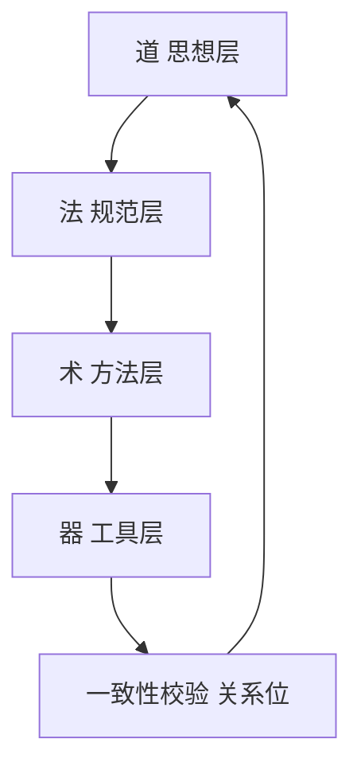

# Xuanspace（玄境）项目蓝图

> **分析视角**：帛书《老子》与「道生一，一生二，二生三，三生万物」
> **方法论编排**：七概念（R → I → E → F → V → C）＋「三之位」诊断
> **Session**：`sc-20261027-xuanspace-boshu-blueprint`
>
> **类比纪律（前置声明）**：本文对《老子》文本与 Xuanspace 工程事实所做的一切比对，均为**结构类比，非影响关系**。二者之间不存在可考的历史影响关系；类比仅提供一个观察角度，不构成因果推导，也不替代工程证据。凡涉及推断之处，均另附可核验的工程事实。
>
> **版本纪律**：本文引用《老子》时区分马王堆甲本／乙本、郭店楚简本、北大汉简本与传世本（河上公本、王弼本等），不使用不分甲、乙的笼统版本称呼；遇甲本损掩处一并标出。
>
> **基线**：Xuanspace `HEAD = 8db593d5fc1ee999c8311f83951e40f15024e2d9`（提交信息 `feat(scripts): 校验 scikit-build-core 下限契约`），工作树干净。

---

## 一、项目定位

Xuanspace（玄境）是一个以 **Python 3.14.6+ 为版本下限**（[pyproject.toml](../pyproject.toml#L12)）、以 **scikit-build-core 为统一 PEP 517 构建后端**（[pyproject.toml](../pyproject.toml#L1-L3)）、以 **PDM workspace 为多包编排机制**（[pyproject.toml](../pyproject.toml#L128-L133)）、以 **Sphinx + MyST 为文档中心**（[doc/conf.py](conf.py#L40-L72)）的单仓多包（monorepo）工程。

其自我宣称的价值取向是「技术为器、思想为道、器以载道」（[README.md](../README.md#L21-L25)），并以此作为目录分层的解释框架。

**命名溯源**：项目自述「玄境」取自《老子》第一章，引文全文见 [doc/intro.md](intro.md#L5-L7)。该处引文采用的是**传世本面貌**（「道可道，非常道」），未标注版本；马王堆甲本／乙本相应文句作「道可道也，非恒道也」（乙本此句不标残损；**甲本此句残**，所据「恒」字为帛书通释，见知识底座 `guoxue/laozi/boshu-reading/concepts/07-core-concepts-interpretation.md` 与 `guoxue/laozi/laozi-works/text/boshu-jia.md`），其差异属汉文帝刘恒避讳改字（「恒」→「常」）。此为可选的精确化事项，不影响项目立意（见建议书 P2-1）。

**范畴边界**：根发行版 `xuanspace` 本身「只承载工作区元信息与开发依赖聚合，不含业务代码」（[src/xuanspace/__init__.py](../src/xuanspace/__init__.py#L1-L11)）；实际能力由 `tools/`、`libs/`、`apps/` 三个分区各自承载。

---

## 二、核心洞察

以下四条洞察采用「现象 → 解释 → 反常识 → 行动」四元组形式。每条均附可核验事实。

### 洞察 I1：同名漂移 —— 文档写得多，但引用的是一张被重构前的地图

- **现象**：`docs/` 与 `doc/` 两种写法**在同一文件内共存**：[AGENTS.md](../AGENTS.md#L66) 写 `docs/`，同文件 [AGENTS.md](../AGENTS.md#L96) 写 `doc/`。逐仓清点为 **7 处、跨 6 个文件**：[AGENTS.md](../AGENTS.md#L66)、[.agents/ONBOARDING.md](../.agents/ONBOARDING.md#L103)、[CHANGELOG.md](../CHANGELOG.md#L13)、[CONTRIBUTING.md](../CONTRIBUTING.md#L709) 与 [CONTRIBUTING.md](../CONTRIBUTING.md#L714)、[doc/architecture.md](architecture.md#L71)、[doc/dependency-report.md](dependency-report.md#L28)；反面一侧写 `doc/` 的是 [README.md](../README.md#L152) 与 [doc/conf.py](conf.py#L101)。判定范围、排除项与复现命令见[优化建议书 P0-1](recommendations.md)。
- **解释**：项目经历过一次目录改名（`docs/` → `doc/`），磁盘与部分引用已更新，全仓引用未做同批次回改；漂移集中在**人写的说明性文本**，机械解析的配置（`path_to_docs = "doc"`）保持正确。
- **反常识**：文档陈旧通常被归因于「没写文档」；此处恰好相反——**文档写得越多，改名后的残留面越大**。漂移量随文档体量**递增**，而非递减。
- **行动**：把路径引用纳入可运行门禁（断链检查）；把制度动作定为「改名 = 同批次全仓引用回改」。
- **缓解性事实（避免夸大）**：原 `doc/README.md`（曾被 [doc/conf.py](conf.py#L48-L54) 的 `exclude_patterns` 排除、不进构建）已在本次「精简迁移」中并入 [doc/index.md](index.md)；上述 7 处**全部是目录树注释或说明性正文，不含链接**，因此不产生断链，重建后的首页 [doc/index.md](index.md) 亦已统一写作 `doc/`。

### 洞察 I2：抽样漂移 —— "现有子项目"表是手工快照，与磁盘事实脱钩

- **现象**：[apps/README.md](../apps/README.md#L87-L92) 的「现有子项目示例」表列出 `xs-cli/`（Python 主 CLI）与 `zhujian-wudao/`（竹简悟道静态应用），而 `apps/` 实际仅含 `.gitkeep` 与 `README.md`；[libs/README.md](../libs/README.md#L106-L111) 仅列 `xuan-core/`、`xuan-ext-demo/`，而 `libs/` 实含 9 项（`caffe-ffi`、`demo-ffi`、`mystx`、`npu-ffi`、`tvm-book`、`xuan-compose`、`xuan-core`、`xuan-ext-demo` 及 README）；[tools/README.md](../tools/README.md#L10-L17) 的目录树未列 `tools/templates/native-ffi/`。
- **解释**：这些表是**手工维护的快照**。新增子项目时被更新的是机械输出（`xs list`），而非 README 中的人写表格；两条轨道以不同速度前进。
- **反常识**：此类漂移**不会在构建或测试中暴露**——README 既不进 Sphinx（部分被 exclude），也不参与任何 CI 断言。因此「CI 全绿」与「文档准确」是两个彼此独立的维度，「全绿」不能证明文档为真。
- **行动**：把「现有子项目表」改为**生成物**（由 `xs list` 或脚本注入），或至少在 CI 增加一条断言。

### 洞察 I3：规范空转 —— 治理先建「法」，实现「器」滞后，形成可判定的欠账

- **现象**：[.meta/README.md](../.meta/README.md#L23-L43) 已完整规定 Markdown 文档的 YAML frontmatter 仅保留 4 字段（`id` 必填、`x-toml-ref` 必填、`source`、`version`），并要求其他元数据落入 `.meta/toml/` 镜像；但 [.agents/rules/frontmatter.md](../.agents/rules/frontmatter.md#L7) 明言「当前阶段（Task 20 之前）不要添加 YAML frontmatter」。实际 `.meta/toml/` 仅含 4 个 TOML（`AGENTS.toml`、`CONTRIBUTING.toml`、`README.toml`、`doc/dependency-report.toml`）与一个 `.gitkeep`。
- **解释**：规范先于实现落地，实现被推迟到一个名为「Task 20」的门槛之后，形成**规范空转期**。
- **反常识**：空转的规范并非纯浪费——它为未来收敛预留了唯一的目标位，使后手不必重新设计。但若无人能回答「Task 20 何时到达」，规范便从「路线图」退化为**矛盾源**：两份文件对同一动作给出相反指令，读者无从判断该服从哪一份。
- **行动**：为「Task 20 门槛」定义**可判定触发条件**（例如：当 `xs meta validate` 具备生成 `.meta/toml/` 的能力且文档总量超过某一阈值），使规范由「有时机」变为「有开关」。

### 洞察 I4：四层解构的价值在依赖方向，不在分类命名

- **现象**：`README.md`、`doc/intro.md`、`doc/architecture.md` 三处均使用「道-法-术-器」四层叙述（[README.md](../README.md#L113-L142)、[doc/architecture.md](architecture.md#L3-L35)）。
- **解释**：这是一个稳定、可复用的组织隐喻，覆盖了从价值主张到可执行产物的完整链条。
- **反常识**：四层解构的真正价值不在于「把东西分成四类」，而在于它**隐含了一个依赖方向约束**（道 → 法 → 术 → 器），而当前这份约束只写在图里、未被任何检查断言。分类是描述性的，方向是规范性的——把描述当规范用，是分层叙事最常见的失效方式。
- **行动**：把「上层可被下层引用、下层不得反向依赖上层」升级为可断言的规则（与 [libs/README.md](../libs/README.md#L115-L118) 已有的「不应依赖 apps」「禁止依赖 scripts/attic/vendor」合并维护）。

---

## 三、道法器术四层解构

> 本节每一层的结构类比均标注「结构类比，非影响关系」。所列「薄弱环节」均为**工程事实**判断，类比不参与该判断。

### 3.1 道 · 思想层

| 维度 | 内容 |
|---|---|
| 对应实体 | [README.md](../README.md#L21-L25) 的价值主张；[doc/intro.md](intro.md#L11-L19) 的「设计哲学」；[doc/architecture.md](architecture.md#L3-L35) Mermaid 图中「道」子图（哲学与文化 / 设计理念） |
| 承载功能 | 提供项目的价值取向与命名合法性，为下层提供「为什么做」 |
| 薄弱环节 | 道层内容**全部为叙事性陈述**，无一条可由工程事实证实或证伪。例如 [doc/intro.md](intro.md#L19)「好的代码不仅是能运行的，更是有思想的」无法对应任何检查项；[doc/intro.md](intro.md#L5-L7) 的引文未标版本 |

*（结构类比，非影响关系：《老子》的「道」为万物本原，此处仅借「不可直接执行、但为下层提供依据」这一结构位置。）*

### 3.2 法 · 规范层

| 维度 | 内容 |
|---|---|
| 对应实体 | [AGENTS.md](../AGENTS.md)、[CONTRIBUTING.md](../CONTRIBUTING.md)、[.agents/rules/frontmatter.md](../.agents/rules/frontmatter.md)、[.meta/README.md](../.meta/README.md)、以及 `apps/`／`libs/`／`tools/`／`vendor/`／`attic/` 五个分区 README |
| 承载功能 | 约束协作方式、目录职责与元数据形态，使多人多智能体协作可预期 |
| 薄弱环节 | 法层**内部自相矛盾，且与实现脱节**：其一，[.meta/README.md](../.meta/README.md#L23-L43) 要求文档携带 frontmatter，而 [.agents/rules/frontmatter.md](../.agents/rules/frontmatter.md#L7) 明令当前阶段不得添加；其二，五个分区 README 的「现有子项目」表与磁盘实际不一致（详见洞察 I2）；其三，[CONTRIBUTING.md](../CONTRIBUTING.md#L212) 称「包含 3 个上游子模块」，而 [.gitmodules](../.gitmodules) 实为 4 个（多 `libs/mystx`） |

*（结构类比，非影响关系：《老子》的「法」在此处对应「可被遵守、可被违反的规则」，而非法律史意义。）*

### 3.3 术 · 方法层

| 维度 | 内容 |
|---|---|
| 对应实体 | [pyproject.toml](../pyproject.toml)（工作区与工具配置）、[CMakePresets.json](../CMakePresets.json)、[.github/workflows/ci.yml](../.github/workflows/ci.yml)、[.github/workflows/release.yml](../.github/workflows/release.yml)、[tools/xs/src/xs/cli.py](../tools/xs/src/xs/cli.py)、[scripts/check_pyproject_style.py](../scripts/check_pyproject_style.py) |
| 承载功能 | 把规范落成可重复执行的流程：构建、测试、发布、校验 |
| 薄弱环节 | 术层**只覆盖「机械可判定」的对象**。[.github/workflows/ci.yml](../.github/workflows/ci.yml#L106-L151) 校验代码风格、类型、测试、文档构建与链接，但不校验**说明性文档与磁盘事实的一致性**（如 README 子项目表、命令清单）。术层的能力边界恰好落在洞察 I2 的盲区上 |

*（结构类比，非影响关系：《老子》未设「术」层，此层名借自先秦「道术」之泛称，仅用于指称「可重复执行的方法」。）*

### 3.4 器 · 工具层

| 维度 | 内容 |
|---|---|
| 对应实体 | `tools/`（`xs`、`okf`、`templates`）、`libs/`（8 个库 + README）、`apps/`（仅 `.gitkeep` 与 `README.md`）、`vendor/`（2 个 submodule 实存，`.gitmodules` 另声明 `libs/` 下 2 个） |
| 承载功能 | 提供可执行的最终产物，是价值的实际落点 |
| 薄弱环节 | 器层**分布极不均衡**：`tools/` 与 `libs/` 充实，`apps/` **为空目录**，而文档仍宣称其含「竹简悟道（HTML/JS 文化应用）」（[doc/architecture.md](architecture.md#L87)）与 `xs-cli/`（[apps/README.md](../apps/README.md#L87-L92)） |

*（结构类比，非影响关系：《老子》「朴散则为器」指道体散为具体器物，此处仅借「最终产物」这一末端位置。）*

### 3.5 四层依赖方向图



图中 `Rel` 为第四节的「关系位」：它不在四层之内，而是使四层互相兑现的那条边。

---

## 四、「三之位」诊断

「三之位」指：「三」不是第三个实体，而是「一」与「二」之间的**关系位**——它回答的不是「还有什么」，而是「二者如何连接、为何构成整体」。以下按五步执行。

### 步骤 1：命名二

Xuanspace 的核心张力可表述为两极：

- **一极（道）**：思想与文化叙事——「技术为器、思想为道」（[README.md](../README.md#L21-L25)）。
- **另一极（器）**：可执行、可验证的工程产物——代码、配置、CI（[pyproject.toml](../pyproject.toml)、[.github/workflows/ci.yml](../.github/workflows/ci.yml)）。

二者的当前状态是**并置而非连接**：文档反复叙述「器以载道」，但没有任何一处把某条主张与某个工程事实绑定。

### 步骤 2：找关系位

关系位**不是**第三个实体（不是「文档团队」「CI 系统」「治理委员会」），而是：

> **「声明—实现一致性」**：每一项文化／哲学主张都必须能落成一条可被工程断言的事实；反之，每一项工程产出都必须能被一句主张解释。

用项目自身的话说，这是「器以载道」的**可执行化**：载道不是修辞上的承载，而是**可核对的承载**。

### 步骤 3：检验非实体性

该关系位不是实体——仓库中**不存在名为「一致性」的目录或模块**。它的全部存在方式是对既有对象的**检查动作**：读取一份声明、读取一份实现、比对二者的差异。删除它不需要删除任何文件，只需停止比对。这正是「关系位」而非「第三实体」的判据。

### 步骤 4：表述为关系

项目的健康度可表述为：

```
健康度 = f(可验证性 × 覆盖度)   而非   f(文档数量 + 代码行数)
```

其中「可验证性」指某条声明被工程断言覆盖的程度，「覆盖度」指受断言约束的声明占比。当前覆盖度接近 0：全部漂移（洞察 I1/I2）都发生在未被断言覆盖的区域。

### 步骤 5：落地动作

把「声明—实现一致性」制度化为**一条可运行的检查**：对可机械提取的声明（子项目清单、命令清单、目录树）改由脚本生成或由 CI 断言，对不可机械提取的声明（价值主张）明确标记为「叙事，不参与断言」。详见建议书 P0-4 与 P1-4。

### 反模式规避（显式声明）

本次诊断**显式规避**以下反模式（命名取自 `dao-san-triads` 技能）：

1. **规避「把第三项当实体」**：未把「一致性校验」立项为一个新部门、新目录或新角色；它只以检查动作形式存在（见步骤 3）。
2. **规避「把结构类比当史实来源」**：全文类比均标注「结构类比，非影响关系」；《老子》与 Xuanspace 无历史影响关系。
3. **规避「停在二无限细分」**：未在「道 vs 器」的对立即止步，也未把两极继续细分为更多子类，而是给出了连接二者的关系位。

（未规避的反模式：「跳过二直接谈三」——本节严格从步骤 1 命名二开始，未直接跳到关系位。）

### 三问检验

1. **第三项能否用「如何连接／为何整体」表述？** 能。关系位回答的是「如何让道与器互相兑现」（如何连接），而非「还有什么东西」。
2. **是否已识别并规避 ≥1 反模式？** 是，已规避 3 条（见上）。
3. **连接方式是否已写成具体动作？** 是。步骤 5 给出具体动作：可机械提取的声明改为生成物或 CI 断言，不可提取的声明标记为「不参与断言」。

---

## 五、现状能力地图

| 能力域 | 现状 | 支撑证据 | 成熟度 |
|---|---|---|---|
| 单仓多包编排 | PDM workspace 覆盖 `apps`／`libs`／`tools` | [pyproject.toml](../pyproject.toml#L128-L133) | 成熟（vendor 未纳入 workspace，属有意取舍） |
| 统一构建后端 | 全仓统一 `scikit_build_core.build`，且有脚本断言版本下限 | [pyproject.toml](../pyproject.toml#L1-L3)、[scripts/check_pyproject_style.py](../scripts/check_pyproject_style.py#L1-L22) | 成熟 |
| CLI 工具面 | `xs` 提供 15 个一级命令（7 个命令组 + 8 个直接命令） | [tools/xs/src/xs/cli.py](../tools/xs/src/xs/cli.py#L43-L88) | 成熟 |
| 文档体系 | Sphinx + MyST，主题按 `mystx` → `sphinx-book-theme` 回退 | [doc/conf.py](conf.py#L40-L72) | 成熟（内容准确性见弱点） |
| 跨平台 CI | 3 OS × 3 包管理器矩阵 | [.github/workflows/ci.yml](../.github/workflows/ci.yml#L23-L25) | 成熟 |
| 发布链路 | tag 触发 PyPI，另有 TestPyPI dry-run | [.github/workflows/release.yml](../.github/workflows/release.yml#L1-L13) | 成熟 |
| 声明一致性 | 无任何断言覆盖，已定位 8 类漂移 | [AGENTS.md](../AGENTS.md#L66) vs [#L96](../AGENTS.md#L96)；[CONTRIBUTING.md](../CONTRIBUTING.md#L212) vs [.gitmodules](../.gitmodules) | **薄弱（本蓝图重点）** |
| 应用层 | `apps/` 为空，但文档宣称有内容 | `apps/` 仅 `.gitkeep` + [README.md](../apps/README.md)；宣称见 [doc/architecture.md](architecture.md#L87) | **薄弱** |
| 元数据体系 | 规范完整但主动冻结，与实现形成矛盾 | [.meta/README.md](../.meta/README.md#L23-L43) vs [.agents/rules/frontmatter.md](../.agents/rules/frontmatter.md#L7) | 冻结中（有明确欠账） |

---

## 六、目标态蓝图

**目标形态（一句话）**：一个「声明可核对、来源唯一、方向可断言」的工作区——读者按任一文档行动时不失败。

三个目标态特征：

1. **声明可核对**：所有可机械提取的声明（子项目清单、命令清单、目录树）要么由脚本生成，要么受 CI 断言约束；不可提取的声明（价值主张）被显式标记为叙事，不参与断言。
2. **单一事实来源**：同一事实（如子模块数量、命令数量、目录名）在仓库内只有一处权威表述，其余位置引用或由生成物派生。
3. **方向可断言**：四层依赖方向（道 → 法 → 术 → 器）与分区依赖规则（`libs` 不得依赖 `apps` 等）由同一份规则文件维护，并可被检查。

**目标态与现状的差距**：落在建议书的分级清单中——差距集中在「声明—实现一致性」这一关系位（P0），外溢为具体的口径统一与清单同步（P1），以及若干精确化事项（P2）。

---

## 七、演进路线

按建议书分级展开，顺序遵循「先关系位、后具体项」——先建立能持续发现漂移的机制，再逐项修正现有漂移；否则修完仍会重新漂移。

| 阶段 | 主题 | 关键动作 | 对应建议 |
|---|---|---|---|
| 第一阶段（修关系位） | 建立一致性门禁 | 可提取声明改为生成物或 CI 断言；定义「Task 20 门槛」的可判定触发条件 | P0-4、P1-4、P1-6 |
| 第二阶段（清存量） | 消除已定案漂移 | 目录口径统一；`apps/` 相关失实声明修正；子模块数量、命令清单、依赖示例、版本下限对齐 | P0-1、P0-2、P0-3、P1-1、P1-2、P1-3、P1-5 |
| 第三阶段（精确化） | 非阻断性提升 | 引文标注版本；上下文漂移修正；检查范围口径对齐；Mermaid 节点去重 | P2-1、P2-2、P2-3、P2-4 |

**说明**：第一与第二阶段可在同一批次内交错推进，但**不建议跳过第一阶段**——在没有门禁的情况下清理存量，漂移会随下一次改名或新增重新出现（洞察 I1/I2 的机制不变）。

---

## 附录：事实清单（R 阶段）

> 本附录为实施计划 Task 1 SubTask 1.6 的产出，为正文各条洞察与建议提供可核验的事实底稿。清单只登记可直接对照的观察项，不含任何因果推断词；来源列给出仓库内相对路径，关键处标到行号；标「目录列举」者由目录枚举直接观察得到。

### A. 语言与构建后端

| # | 事实 | 来源 |
|---|---|---|
| 1 | 根 `pyproject.toml` 声明 `requires-python = ">=3.14.6"` | [pyproject.toml](../pyproject.toml#L12) |
| 2 | 根 `pyproject.toml` 声明构建后端 `scikit_build_core.build`，构建依赖下限 `scikit-build-core>=0.11` | [pyproject.toml](../pyproject.toml#L1-L3) |
| 3 | 根 `pyproject.toml` 声明许可证 `Apache-2.0` | [pyproject.toml](../pyproject.toml#L10) |
| 4 | `libs/README.md` 第 102 行声明 scikit-build-core 下限 `>=0.5` | [libs/README.md](../libs/README.md#L102) |
| 5 | `libs/xuan-ext-demo/pyproject.toml` 构建依赖含 `scikit-build-core>=0.11`、`cmake>=3.26`、`ninja` | [pyproject.toml](../libs/xuan-ext-demo/pyproject.toml) |
| 6 | `libs/xuan-core/pyproject.toml` 设 `wheel.cmake = false`、`packages = ["src/xuan_core"]` | [pyproject.toml](../libs/xuan-core/pyproject.toml) |
| 7 | `scripts/check_pyproject_style.py` 的 `SCAN_DIRS` 为 `["." , "libs", "tools"]` | [check_pyproject_style.py](../scripts/check_pyproject_style.py) |
| 8 | `CMakePresets.json` 声明 `version: 6` 与 `cmakeMinimumRequired` 3.26.0 | [CMakePresets.json](../CMakePresets.json#L1-L4) |

### B. 目录结构与包编排

| # | 事实 | 来源 |
|---|---|---|
| 9 | 根 `pyproject.toml` 的 PDM workspace `packages` 含 `apps`、`libs`、`tools` 三个来源项，不含 `vendor` | [pyproject.toml](../pyproject.toml#L128-L133) |
| 10 | `src/xuanspace/__init__.py` 自述根发行版「只承载工作区元信息与开发依赖聚合，不含业务代码」 | [__init__.py](../src/xuanspace/__init__.py#L1-L11) |
| 11 | `apps/` 目录含两项：`.gitkeep` 与 `README.md` | 目录列举 |
| 12 | `apps/README.md` 第 87–92 行的「现有子项目示例」表列 `xs-cli/` 与 `zhujian-wudao/` | [apps/README.md](../apps/README.md#L87-L92) |
| 13 | `libs/` 目录含 8 个子目录：`caffe-ffi`、`demo-ffi`、`mystx`、`npu-ffi`、`tvm-book`、`xuan-compose`、`xuan-core`、`xuan-ext-demo`，另有 `.gitkeep` 与 `README.md` | 目录列举 |
| 14 | `libs/README.md` 第 106–111 行列出 `xuan-core/`、`xuan-ext-demo/` 两项 | [libs/README.md](../libs/README.md#L106-L111) |
| 15 | `libs/README.md` 第 115–118 行声明分区依赖规则（「不应依赖 apps」「禁止依赖 scripts/attic/vendor」） | [libs/README.md](../libs/README.md#L115-L118) |
| 16 | `tools/README.md` 第 10–17 行目录树未列 `tools/templates/native-ffi/` | [tools/README.md](../tools/README.md#L10-L17) |
| 17 | `scripts/` 目录含三项：`.gitkeep`、`README.md`、`check_pyproject_style.py` | 目录列举 |

### C. CLI 与工具面

| # | 事实 | 来源 |
|---|---|---|
| 18 | `tools/xs/src/xs/cli.py` 第 43–49 行含 7 个 `add_typer` 注册项 | [cli.py](../tools/xs/src/xs/cli.py#L43-L49) |
| 19 | 同文件第 79–85 行含 7 个 `app.command` 注册项 | [cli.py](../tools/xs/src/xs/cli.py#L79-L85) |
| 20 | 同文件第 88 行含 `@app.command("affected")` 一项 | [cli.py](../tools/xs/src/xs/cli.py#L88) |
| 21 | `xs` 一级注册项合计 15 个（7 + 7 + 1），与 `README.md` 第 101 行的「15 个子命令」数量相同 | [README.md](../README.md#L101) |
| 22 | `tools/xs/src/xs/commands/` 含 14 个命令模块与一个 `__init__.py` | 目录列举 |
| 23 | `doc/intro.md` 第 43–58 行列 12 条命令 | [intro.md](intro.md#L43-L58) |
| 24 | `CHANGELOG.md` 第 12 行记 12 条命令 | [CHANGELOG.md](../CHANGELOG.md#L12) |
| 25 | `tools/okf/pyproject.toml` 声明 name `okf-kit`、`dependencies = []`、脚本入口 `okf = "okf.__main__:main"` | [pyproject.toml](../tools/okf/pyproject.toml) |

### D. 文档体系

| # | 事实 | 来源 |
|---|---|---|
| 26 | `doc/conf.py` 第 48–54 行 `exclude_patterns` 含 `"README.md"` | [conf.py](conf.py#L48-L54) |
| 27 | `doc/conf.py` 第 56 行 `master_doc = "index"`，第 101 行 `path_to_docs = "doc"` | [conf.py](conf.py#L56)、[conf.py](conf.py#L101) |
| 28 | `doc/conf.py` 第 40–72 行主题回退顺序为 `mystx` → `sphinx_book_theme` → `alabaster`；第 74 行 `html_title = "Xuanspace（玄境）"` | [conf.py](conf.py#L40-L72)、[conf.py](conf.py#L74) |
| 29 | 原 `doc/README.md` 与 `doc/index.md` 结构重复（两份入口）；已按「精简迁移」合并为 `doc/index.md` 单份，原 `doc/README.md` 删除，其 3 处 `docs/` 漂移随之消失 | [doc/index.md](index.md) |
| 30 | `AGENTS.md` 第 66 行用 `docs/`，同文件第 96 行用 `doc/` | [AGENTS.md](../AGENTS.md#L66)、[AGENTS.md](../AGENTS.md#L96) |
| 31 | 根文档目录命名漂移合计 7 处、跨 6 个文件；除第 30 条所列 `AGENTS.md` 1 处外，另 6 处为 `.agents/ONBOARDING.md` 第 103 行、`CHANGELOG.md` 第 13 行、`CONTRIBUTING.md` 第 709／714 行、`doc/architecture.md` 第 71 行、`doc/dependency-report.md` 第 28 行 | [ONBOARDING.md](../.agents/ONBOARDING.md#L103)、[CHANGELOG.md](../CHANGELOG.md#L13)、[CONTRIBUTING.md](../CONTRIBUTING.md#L709)、[CONTRIBUTING.md](../CONTRIBUTING.md#L714)、[architecture.md](architecture.md#L71)、[dependency-report.md](dependency-report.md#L28) |
| 32 | `doc/architecture.md` 第 78 行声明仓库根存在 `CMakeLists.txt`；仓库根目录无该文件 | [architecture.md](architecture.md#L78) |

### E. 治理与 CI

| # | 事实 | 来源 |
|---|---|---|
| 33 | `.gitmodules` 登记 4 个子模块：`vendor/tvm-ffi`、`libs/tvm-book`、`vendor/caffe`、`libs/mystx` | [.gitmodules](../.gitmodules) |
| 34 | `CONTRIBUTING.md` 第 212 行称含 3 个子模块；第 216–218 行的表列三行 | [CONTRIBUTING.md](../CONTRIBUTING.md#L212)、[CONTRIBUTING.md](../CONTRIBUTING.md#L216-L218) |
| 35 | `vendor/README.md` 第 88–91 行「现有子项目」表列 2 行；第 86 行写「（待实际添加后更新此表）」 | [vendor/README.md](../vendor/README.md#L86-L91) |
| 36 | `.meta/README.md` 第 23–43 行规定 frontmatter 四字段（`id` 必填、`x-toml-ref` 必填、`source`、`version`） | [.meta/README.md](../.meta/README.md#L23-L43) |
| 37 | `.agents/rules/frontmatter.md` 第 7 行写「当前阶段（Task 20 之前）不要添加 YAML frontmatter」 | [frontmatter.md](../.agents/rules/frontmatter.md#L7) |
| 38 | `.meta/toml/` 含 4 个 TOML（`AGENTS.toml`、`CONTRIBUTING.toml`、`README.toml`、`doc/dependency-report.toml`）与 `.gitkeep` | 目录列举 |
| 39 | `.github/workflows/ci.yml` 共 309 行、4 个 job（`test`、`quality`、`template-validation`、`py-compat`）；第 23–25 行矩阵为 3 OS × 3 包管理器 | [ci.yml](../.github/workflows/ci.yml#L23-L25) |
| 40 | `ci.yml` 第 113 行 mypy 范围限于 `tools/xs`、`libs/xuan-core`、`libs/xuan-ext-demo` | [ci.yml](../.github/workflows/ci.yml#L113) |
| 41 | `.github/workflows/release.yml` 共 95 行；`release` job 由 tag `xs-cli-v*` 触发；`dry-run` job 由 `workflow_dispatch` 触发并指向 TestPyPI `https://test.pypi.org/legacy/` | [release.yml](../.github/workflows/release.yml) |

### F. 引文与叙述

| # | 事实 | 来源 |
|---|---|---|
| 42 | `doc/intro.md` 第 5–7 行引《老子》第一章文句，作传世本面貌（「道可道，非常道」），未标版本 | [intro.md](intro.md#L5-L7) |
| 43 | `README.md` 第 21–25 行表述「技术为器、思想为道、器以载道」 | [README.md](../README.md#L21-L25) |
| 44 | `README.md` 第 113–142 行使用「道-法-术-器」四层叙述 | [README.md](../README.md#L113-L142) |
| 45 | 基线提交为 `8db593d5fc1ee999c8311f83951e40f15024e2d9`，提交信息 `feat(scripts): 校验 scikit-build-core 下限契约` | `git log -1` |

---

*本文与配套的 [优化建议书](recommendations.md) 同批次产出；两份文档均以 H1 开头，不携带 YAML frontmatter，不创建 `.meta/toml/` 镜像（遵循 [.agents/rules/frontmatter.md](../.agents/rules/frontmatter.md#L7) 的当前阶段约束）。*
