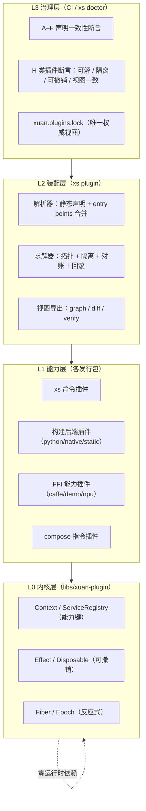
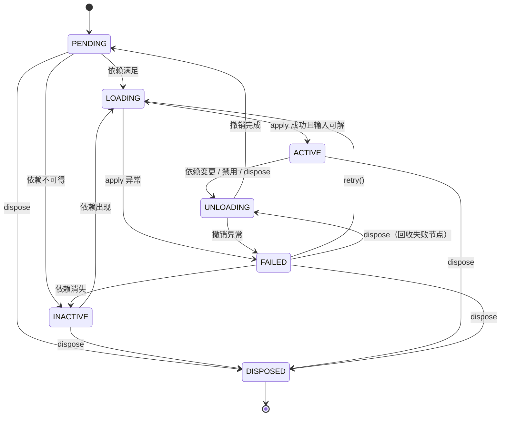

> 原子化来源：[xuanspace-pluginization-design.md](file:///media/pc/data/ai/.agents/archive/xuanspace-pluginization-design-20261123/raw/xuanspace-pluginization-design.md) · 原文 §5（L235–L396）
> 文档索引：[README.md](README.md)

## 5. 方案：Xuan Plugin Contract（XPC）

### 5.1 分层架构



**关键约束**：L0 零第三方运行时依赖（沿用 `okf` 现状）；L1 只依赖 L0 与 `xuan-core`；L2 可依赖 L1；L3 只读，不参与运行期。

### 5.2 五张契约

| 契约 | 名称 | 内容 | 违约检测 |
|---|---|---|---|
| K1 | 能力键 | 语法 `xuan:<domain>/<owner>#<api>`；元数据 `single/multi`；所有者域唯一 | 键名正则 + 域归属表断言 |
| K2 | 插件清单 | 字段：`id, version, inject[], provide[], isolate[], config_schema, reversible, priority, disabled, lifecycle`（`lifecycle ∈ {reloadable, static}`，原生后端固定 `static`，见 ADR-03） | schema 校验 + 清单/实现双向一致 |
| K3 | 可撤销 | 所有登记返回 `Disposable`；卸载逆序执行；异常聚合不吞 | AST 扫描（模块级可变单例/裸写全局表）+ 运行时残留断言 |
| K4 | 版本化上下文 | 依赖身份 = `(key, impl_digest, config_digest)`；变更按依赖集传播 | 同一 lock 两次装配摘要必须相等 |
| K5 | 隔离与作用域 | 同装配内 provide 两两不交（`multi` 显式声明的除外）；越界访问记 UNDECLARED_ACCESS | 装配期冲突检测 + 运行期访问审计 |

### 5.3 清单示例（落位：各发行包 `pyproject.toml`）

```toml
[project.entry-points."xuan.plugins"]
xs.commands = "xs.plugins.commands:CommandPlugin"

[tool.xuan.plugin]
id = "xs.commands"
version = "0.1.0"
reversible = true
priority = 100
lifecycle = "reloadable"      # 纯 Python 可热换；原生后端固定 "static"（ADR-03）
isolate = ["env:workspace"]

[[tool.xuan.plugin.provide]]
key = "xuan:cli/commands#register"
mode = "single"

[[tool.xuan.plugin.inject]]
key = "xuan:build/backend#dispatch"
optional = false
constraint = "methods:build(spec)->artifact"   # 结构约束，非字符串版本
```

要点：
- **结构约束替代版本号**（F16）：`constraint` 描述所需方法集与签名，装配期用 `inspect.signature` 校验。
- **`isolate`** 声明该插件不得与之共享上下文的域（对应论文的 isolate 字段）。
- **`reversible = false`** 仅允许用于无副作用的纯计算插件；其余一律要求可撤销。

### 5.4 装配算法（与论文对账）

```text
resolve(target_view) -> committed_view
  1. collect   : 静态声明 ∪ entry points  → 候选节点集 N
  2. normalize : 补全默认值；键规范化；冲突按键聚合（priority, 显式选择）
  3. graph     : 边 = inject.key -> provide.key；缺失 required 依赖的节点标 INACTIVE（不失败）
  4. cycles    : 同 id 内允许（peer 语义）；跨 id 环 → 报最小环并终止
  5. order     : 拓扑排序（同层按 priority、再按 id 字典序 —— 保证确定性）
  6. apply     : 逐节点 装/卸/换；每步校验 provide 冲突（隔离）
  7. reconcile : 与旧 committed_view 逐字段 diff；未变字段不动作
  8. rollback  : 任一步失败 → 逆序撤销本批已生效步骤，恢复旧视图
  9. quiesce   : 断言所有 ACTIVE 依赖可解，且无"可激活未激活"节点
 10. commit    : 写出 committed_view + lock（含每个节点的身份摘要）
```

| 算法步骤 | 论文依据 | 工程收益 |
|---|---|---|
| 3（INACTIVE 而非报错） | §5.1 算法 6 | 可选能力可缺失，装配不中断 |
| 5（确定性排序） | Theorem 63 顺序无关 | 同声明必得同装配，可缓存 |
| 7（逐字段对账） | Definition 74 / Theorem 73 | 只重载变更项，缩短反馈环 |
| 8（事务回滚） | §5.2 备份—恢复 | 热替换不留半成品状态 |
| 9（静默断言） | Theorem 66 / 73 | 把"最终一致"变成可检测性质 |

### 5.5 生命周期状态机



> 上图为 P2-4 / P2-8 / P2-9 落地后的**实际迁移表**（15 条边），与 `libs/xuan-plugin/src/xuan_plugin/plugin.py` 的 `_TRANSITIONS` 逐条一致，由 `test_lifecycle.py` 对 7×7 状态对穷举守护；表外调用（如对 `ACTIVE` 调 `retry()`、对 `DISPOSED` 再加载）抛 `FiberTransitionError`，不做静默降级。设计初稿的 11 条边缺 `INACTIVE→DISPOSED`、`FAILED→INACTIVE`、`FAILED→UNLOADING`、`UNLOADING→FAILED` 四条运行期边，已按代码事实补齐。

| 状态 | 不变量 | 可观测证据 |
|---|---|---|
| PENDING | 未持有任何 effect | effect 数 = 0 |
| INACTIVE | 未持有 effect，且原因可解释；依赖恢复后自动重新装配 | `reason = missing(key...)` |
| ACTIVE | provide 全部已登记；**输入快照可解**（`ACTIVE ⇒ _inputs is not None`） | 视图节点 `active=true` |
| FAILED | 已登记 effect 全部撤销；`FAILED ⇔ error is not None` | effect 数 = 0，`error` 非空 |
| UNLOADING | 撤销进行中；成功后清空 `error` 并回 `PENDING` | 迁移期间不可重入 |
| DISPOSED | 终态，句柄不可再用 | 二次 dispose 幂等 |

依赖方只在**最终视图**上判定：`_refresh`、`retry`、`Context.plugin` 各处于一次传播事务内，多键提供方的卸载/装载通知合并排空（P2-5 / P2-6），故一次逻辑变更只产生一轮替换，不会看到「键暂时缺失」的中间态。

### 5.6 与既有资产的关系（不重写，只收敛）

| 既有资产 | 处理方式 | 理由 |
|---|---|---|
| `tools/okf` kernel | 抽出为 `libs/xuan-plugin`；`okf` 改为依赖它 | 解除 S3/S15 的方向限制；避免二次实现 |
| `tools/okf` 的 `Harness` | 升级为 L2 `xs plugin` 求解器（或 `libs/xuan-plugin` 的 `Assembler`） | 当前缺隔离/对账/回滚（S14） |
| `tools/xs` 的 14 个静态 import | 改为命令插件 + entry points 双通道 | 消除 I3；保留静态通道作为"内置插件" |
| `libs/xuan-cmd` | 提供 `xuan:cli/commands#register` 的**单提供者实现**，作为键的参考实现 | 其定位本就是"命令装配" |
| `libs/xuan-compose` 的处理器表 | 改为向 `xuan:compose/commands#register` 登记并返回 Disposable | 静态表是 I2 的典型症状 |
| 构建后端（python/native/static） | 抽象为 `xuan:build/backend#dispatch` 的 multi 提供者 | 对应 P5；`xs new` 的模板选择即"按标签选择" |
| FFI 库（caffe/demo/npu） | 抽象为 `xuan:ffi/<name>#api`，能力句柄可撤销、库不卸载 | 见 V1 的边界 |
| 声明快照 | 降级为 `xuan.plugins.lock` 的派生视图 | 消除 I4 双真相 |
| `xs doctor` | 增加 `--plugins` 输出装配图、冲突、INACTIVE 原因 | 复用现有可观测入口 |

### 5.7 治理门禁扩展（H 类断言）

在既有 A–G 类之后新增 H 类，全部为**只读、可复现**断言：

| 断言 | 检查内容 | 失败信息要求 |
|---|---|---|
| H1 可解性 | 所有 required 依赖在候选集合内可满足，或节点被合法标 INACTIVE | 列出缺失键与引用者 |
| H2 隔离性 | 同装配 provide 两两不交（`multi` 除外）；`multi` 键内须 `priority` 唯一，同值且无显式 `provider` 即判冲突 | 列出冲突键与双方 id |
| H3 可撤销性 | 插件登记均返回句柄；AST 扫描无裸写全局表/模块级可变单例 | 给出文件:行号 |
| H4 视图一致性 | `xuan.plugins.lock` 可由当前声明与磁盘重算得到（字节级一致） | 给出 diff |
| H5 结构兼容 | `inject.constraint` 与提供实现的签名匹配 | 列出缺失方法/参数漂移 |

> 门禁哲学与论文一致：**不检查"是否写过文档"，只检查"解是否唯一可复现"**。

---

相关页面：[文档索引](README.md) · 上一篇：[F — 第一性原理](04-first-principles.md) · 下一篇：[V — 对抗审查（4 视角）](06-adversarial-review.md)
